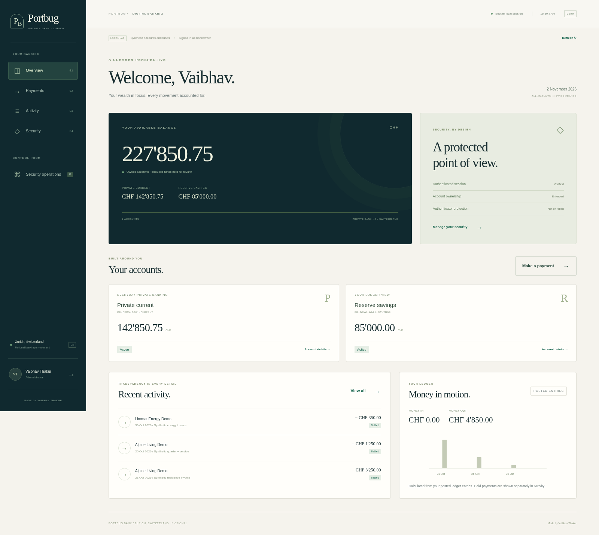

# Portbug Bank · Secure Digital Banking

**Made by Vaibhav Thakur.** A private-banking application for a fictional Zurich bank, with security controls built into the payment workflow.

Explore synthetic CHF accounts, send local demonstration payments, review transaction history, and investigate the security decisions behind each payment. Risky instructions reserve funds for independent review; a second operator must approve or reject them. The banking application and security workspace share one auditable ledger rather than disconnected dashboard counters.



Also see the [security workbench preview](docs/security-workbench.png) and [validation record](docs/validation.md).

## Start the bank

Install **Python 3.12 or later**. The application uses the standard library and local browser assets; no Make, npm installation, Python packages, cloud account, or default credentials are needed.

```bat
:: Windows Command Prompt
git clone https://github.com/Vaibhav222209/Cybersecurity_1.4.git
cd Cybersecurity_1.4
py -m portbug
```

```sh
# Linux / macOS, from the project folder
python3 -m portbug
```

Open **http://127.0.0.1:8080**. On first launch, create your local administrator account with a new password of at least 12 characters. Use a password created for this demonstration, not a real banking password. Keep the terminal running; **Ctrl+C** stops the application.

Already cloned the repository? Run `git pull --ff-only origin main` from that folder before starting. The banking rebuild uses a new `.local-banking/` data directory; it does not reuse the previous dashboard's database.

If another application uses port 8080, run `py -m portbug --port 8081` on Windows or `python3 -m portbug --port 8081` elsewhere. `py --list` shows your installed Windows Python versions. Optional container startup is `docker compose up --build`.

## Banking, with decisions you can inspect

| Workspace | What you can do |
| --- | --- |
| Banking home | Inspect your own synthetic current/savings accounts and available balances |
| Payments | Choose a beneficiary, review an instruction, submit it with an idempotency key, and see settlement or a review hold |
| Activity | Follow the actual local ledger and payment status rather than illustrative traffic counters |
| Personal security | Enroll optional authenticator-based TOTP verification and manage your signed-in session |
| Security operations | Review held payments, investigate their reasons and event timelines, and record an independent approval/rejection |
| Detection workbench | Change permitted risk thresholds and backtest candidate settings against labeled cases with a confusion matrix |
| Administration | Create separate customer and operator accounts with their own credentials and role boundaries |

All accounts, beneficiaries, funds, and events are synthetic. No payment leaves this application or reaches a bank, clearing system, card network, or SWIFT.

## Try the complete payment-control workflow

1. Create your first administrator account. Its banking home has synthetic starter accounts and funds.
2. Make a modest payment to a trusted demonstration beneficiary. Inspect its receipt and resulting balance changes.
3. Submit a payment at or above the default **CHF 10,000** review threshold. The sender's funds are reserved and the instruction enters the review queue.
4. Create a separate **operator** through administration, using another local username and password.
5. Sign in as that operator in a separate browser profile or after logging out. Review the held payment, its fraud reasons, and its case timeline; add a decision note and approve or reject it.
6. Return to the sender's account. Approval credits the synthetic recipient; rejection returns the reserved funds. The sender cannot approve their own instruction.
7. Compare candidate thresholds in the workbench, then inspect or export the resulting evidence.

The production meaning of a control is kept separate from what the local demonstration proves. A real bank would additionally need independent custody, production IAM, protected network boundaries, regulated operations, and external payment integrations.

## Controls that govern the application

| Control | Implemented behavior |
| --- | --- |
| Authentication | Operator-chosen passwords stored with scrypt; opaque server-side sessions; optional TOTP enrollment and verification |
| Role and ownership checks | Customers see their own banking records; operator/admin actions have separate role checks; account ownership is enforced on the server |
| Payment integrity | Integer CHF cents, balance checks, atomic state changes, idempotent submission, and conserved funds across settled and held instructions |
| Independent review | High-risk instructions cannot be approved by their author; decisions require a note and follow the permitted state transition |
| Fraud explanations | Rule decisions expose their contributing reasons; adjustable thresholds are evaluated against labeled backtest cases |
| Browser boundary | Exact Host/Origin checks, CSRF protection, request limits, local static assets, and restrictive security headers |
| Evidence | SQLite persistence plus a keyed, state-bound HMAC audit chain; modified evidence blocks further banking mutations |
| Recovery | Verified database/key backup and isolated restoration procedures |

The audit chain protects against unkeyed changes while its local key remains trusted. It is not immutable storage: a host administrator controlling the key and database can rewrite history. Authentication tables share that host trust domain and are not included in the banking-state digest. The application uses loopback HTTP and unencrypted local SQLite; production TLS, encrypted storage, independent logs, and hardware key custody are separate requirements.

## Verify it

```bat
:: Windows
py -m unittest discover -s tests -v
py tools\check.py
```

```sh
# Linux / macOS
python3 -m unittest discover -s tests -v
python3 tools/check.py
```

Developers with Node installed can also run `node --check portbug/static/app.js`. Node is not needed to use the banking application. The [CI workflow](.github/workflows/ci.yml) configures Windows/Linux checks on Python 3.12 and 3.14; inspect completed runs before claiming a platform combination passes.

## Engineering documentation

- [Architecture and trust boundaries](docs/architecture.md)
- [Threat model and verification requirements](docs/threat-model.md)
- [Operations, account separation, backup and recovery](docs/operations.md)
- [Security reporting and deployment limits](SECURITY.md)
- [Contributor workflow](CONTRIBUTING.md)

Portbug Bank is fictional. Zurich is the modeled headquarters; this repository does not attest Swiss data residency, banking authorization, or regulatory compliance.

**Portbug Bank — made by Vaibhav Thakur.** Licensed under the [MIT License](LICENSE).
