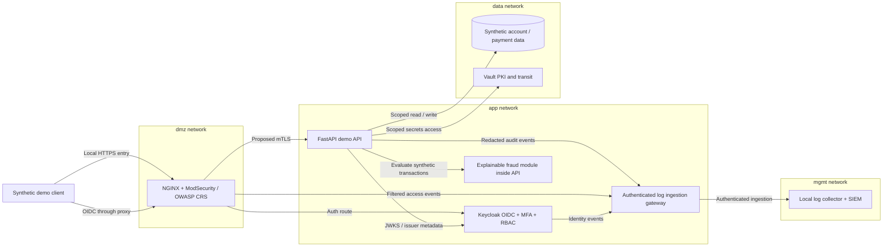

# portburg-secure-bank

**Made by Vaibhav Thakur** — a practical defensive cybersecurity project.

A defensive cybersecurity portfolio for **Portburg Bank**, a fictional private bank headquartered in Zurich, Switzerland. All examples and future demonstration data are synthetic. This project is for education, not production banking or a claim of regulatory compliance.

**Status: Phase 1 complete — scaffold and design.** No banking API, containers, identity provider, WAF, SIEM, or scanner pipeline has been implemented yet. See the [seven-phase roadmap](docs/roadmap.md) for delivery and validation gates.

## Quickstart: current phase

Requirements: Git, GNU Make, and Python **3.12**. No third-party Python packages, credentials, or cloud accounts are needed for Phase 1.

```sh
git clone https://github.com/Vaibhav222209/Cybersecurity_1.4.git
cd Cybersecurity_1.4
python3 --version
make lint
make test
```

On Windows Command Prompt, Make is optional. From the project folder, run:

```bat
py -3.12 tools\check_repository.py
py -3.12 -m unittest discover -s tests -v
```

Use `py --list` to check installed Python versions. If 3.12 is missing, install Python 3.12 and reopen the terminal. The project targets 3.12; a different `python3` version is not a substitute. Git attributes keep text files in LF format on all platforms, and test fixtures explicitly use LF rather than the operating system's default line endings.

The project name is `portburg-secure-bank`; the existing GitHub repository name remains `Cybersecurity_1.4`. These commands work against the Phase 1 commit after it has been pushed. The onboarding checkout currently uses the local `work` branch.

`make lint` checks document links, text hygiene, Python syntax, structured JSON, and accidental private-key material. `make test` exercises the checker against valid and deliberately broken fixtures and verifies the actual scaffold. These are documentation checks, not application security tests or a complete secrets scanner.

`make up` will start the local Docker Compose lab in Phase 2. `make scan` will invoke the real security scanners in Phase 3. Both commands currently exit with a clear error; no services need to be stopped in this phase. Future dependencies and images will be pinned before use.

## Proposed architecture



This is a design, not a running deployment. Boxes show primary logical zones; multi-network service membership and separate administration paths are specified in the [architecture and trust boundaries](docs/architecture.md). Docker networks provide connectivity separation, not complete zero-trust enforcement. Service identities, authorization, egress policy, encryption, and host controls require implementation and validation.

## Threat summary

The [threat model](docs/threat-model.md) covers spoofed identities, transaction tampering, missing audit evidence, data disclosure, resource exhaustion, privilege escalation, and supply-chain compromise. Intended mitigations include MFA and scoped authorization, strict token and input validation, WAF rules, redacted structured logging, service authentication, and reproducible builds. No mitigation is claimed operational in Phase 1.

The project contains no malware, exploits, attack automation, real bank integrations, real customer records, or real payment credentials. Future synthetic account identifiers will be visibly non-routable (for example, `PB-DEMO-ACCOUNT-001`), not valid banking destinations. Detection scenarios will generate local event fixtures only.

## Repository map

| Path | Responsibility | Delivery |
| --- | --- | --- |
| [AGENTS.md](AGENTS.md) | Conventions, commands, definition of done | Phase 1 |
| [docs/](docs/README.md) | Architecture, threats, decisions, governance | Phases 1 and 6 |
| [app/](app/README.md) | Minimal secure FastAPI demo | Phase 2 |
| [infra/](infra/README.md) | Compose, reverse proxy/WAF, IAM, Vault | Phase 2 |
| [devsecops/](devsecops/README.md) | Scanners, SBOM, signing, policy as code | Phase 3 |
| [detection/](detection/README.md) | SIEM, Sigma, synthetic event generator | Phase 4 |
| [fraud/](fraud/README.md) | Explainable rules and small ML baseline | Phase 5 |
| [pentest-lab/](pentest-lab/README.md) | Defensive local verification reports | Phases 2–7 |
| [tests/](tests/README.md) | Phase-specific validation | Each phase |
| [tools/check_repository.py](tools/check_repository.py) | Dependency-free scaffold linter | Phase 1 |

Governance deliverables will map controls to verified primary sources, including Swiss requirements and international frameworks. They will distinguish applicability, assumptions, gaps, and evidence. No legal review or framework certification is implied. The Switzerland-only data-residency requirement is a **deployment assumption**, not a guarantee about this cloud development host; see [ADR 0001](docs/adr/0001-local-defensive-lab.md).

## Contributing and license

Follow [AGENTS.md](AGENTS.md), keep changes within the requested phase, run both validation commands, and use conventional commits. Never commit `.env`, private keys, credentials, or real personal data. [`.env.example`](.env.example) documents future configuration without secrets. The project is licensed under the [MIT License](LICENSE).
