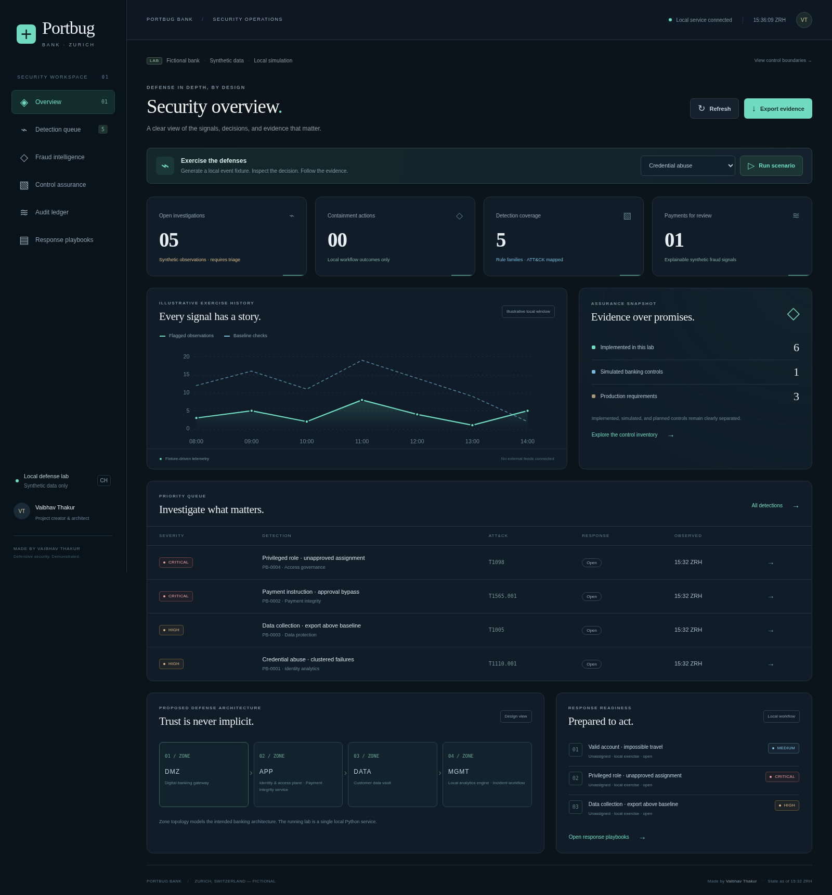
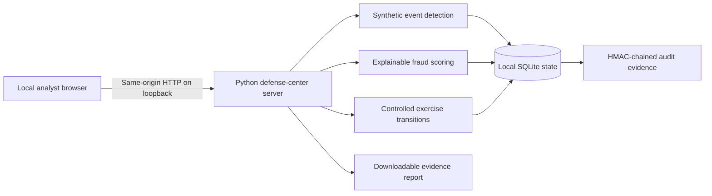

# Portbug Bank · Cyber Defense Center

**Made by Vaibhav Thakur.** A practical cybersecurity engineering project for a **fictional private bank in Zurich, Switzerland**.

A runnable security operations console with synthetic detection scenarios, explainable payment-risk signals, controlled incident workflows, and verifiable audit evidence. The interface is backed by local Python logic and persistent state; scenario buttons exercise the detection engine rather than merely changing a dashboard counter.



## Run it

Install **Python 3.12 or later**. No Make, npm installation, Python packages, cloud account, or credentials are required to run the application.

```bat
:: Windows Command Prompt — from the project folder
py -m portbug
```

```sh
# Linux / macOS — from the project folder
python3 -m portbug
```

Open **http://127.0.0.1:8080** in your browser. Keep the terminal open; press **Ctrl+C** to stop. If that port is occupied, add `--port 8081` and open the corresponding address. On Windows, `py --list` shows installed Python versions; select an installed supported version explicitly with `py -3.12 -m portbug` or `py -3.14 -m portbug` if necessary.

To download the project first:

```sh
git clone https://github.com/Vaibhav222209/Cybersecurity_1.4.git
cd Cybersecurity_1.4
```

Optional Docker startup: `docker compose up --build`. The Compose port is published on host loopback. See [operations](docs/operations.md) for persistence, shutdown, backup, and recovery.

## Explore the defense center

1. Review the overview, asset zones, and synthetic alert queue.
2. Select a scenario such as **credential abuse**, **payment change**, or **data export**, then run it. All events are generated locally; no attack or network scan is performed.
3. Inspect the resulting detection, its reason, severity, and ATT&CK technique reference.
4. Move an alert through **triage → contain → resolve**. These actions update the local exercise only; they do not control a real identity provider or payment system.
5. Review fraud reason codes and distinguish **implemented**, **simulated**, and **planned** controls.
6. Inspect the audit chain and download the evidence report. Repeat a benign baseline scenario to compare positive and negative detection behavior.

## What works

| Capability | Implementation |
| --- | --- |
| Defensive detection | Local event rules for suspicious authentication, geography, privilege changes, exports, and payment-instruction changes; synthetic fixtures and tests |
| Fraud review | Deterministic risk scoring with human-readable reasons; advisory outputs only |
| Incident operations | Ordered state transitions with rejected invalid actions and linked exercise records |
| Evidence trail | Atomic SQLite state updates and an HMAC-SHA256 audit chain using a locally generated, uncommitted key |
| Local HTTP safeguards | Loopback default, request validation and limits, same-origin write checks, CSRF protection, and restrictive browser security headers |
| Operator interface | Responsive dashboard, scenario controls, alert details, fraud review, control evidence, audit inspection, and runbooks |
| Reproducible development | Standard-library Python runtime/tests; plain local HTML, CSS, and JavaScript; Windows and Linux CI workflow |

The project models advanced preparation without claiming a production deployment. MFA/SSO, WAF, service mTLS, managed SIEM, hardware key custody, encrypted storage, and production network enforcement are **not integrated here**. The console labels modeled controls separately. Local HTTP is not TLS, SQLite is not encrypted, and an administrator holding the audit key can rewrite the chain. Swiss residency is an architectural assumption, not an attestation about your computer or this development environment.

Initial findings and chart history are seeded illustrative data, not measured bank telemetry. Fraud scoring uses explainable rules, not a trained ML model. New scenario actions produce actual local state changes and audit entries.

## Architecture



The displayed bank zones are a **modeled topology**, not separately deployed banking networks. See [architecture and boundaries](docs/architecture.md), the [STRIDE threat model](docs/threat-model.md), and the [risk/control register](docs/control-register.csv).

## Verify the project

```bat
:: Windows
py -3.12 -m unittest discover -s tests -v
py -3.12 tools\check.py
```

```sh
# Linux / macOS
python3 -m unittest discover -s tests -v
python3 tools/check.py
```

With Node installed, `node --check portbug/static/app.js` also checks JavaScript syntax. Node is a development check, not a runtime dependency. The [CI workflow](.github/workflows/ci.yml) runs checks on Windows and Linux; a workflow file alone is not proof of a completed passing CI run.

See the [validation record](docs/validation.md) for the checks performed during this rebuild and their limits.

## Security preparation and scope

- [Incident playbooks](docs/incident-playbooks.md): credential abuse, suspicious payments, data export, privileged changes, and recovery.
- [Operations](docs/operations.md): local startup, evidence, backups, and restoration.
- [Control register](docs/control-register.csv): risk owners, treatments, current status, and evidence requirements.
- [Security policy](SECURITY.md): safe reporting and defensive testing boundaries.
- [Contributing](CONTRIBUTING.md): commands, synthetic-data conventions, and review requirements.

All customer-like identities, account identifiers, event histories, and transaction records are synthetic. The application does not connect to real banks, SWIFT, payment networks, threat-intelligence services, or external telemetry. Framework references are educational; no banking authorization, compliance certification, or legal assurance is claimed.

Licensed under the [MIT License](LICENSE). **Portbug Bank Cyber Defense Center — made by Vaibhav Thakur.**
