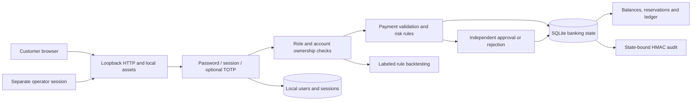

# Architecture: banking decisions under security controls

**Portbug Bank · Zurich · Made by Vaibhav Thakur.** The running system is a local banking application for synthetic CHF accounts. It combines customer workflows and a separately authorized operator workspace.

## Runtime and data flow

The standard-library Python server serves only its explicit local asset/API routes. The browser submits structured requests; the server authenticates and validates every mutation. The interface is not an authorization boundary. No workflow contacts a bank, clearing network, card processor, external identity provider, or telemetry service.

## Identity and roles

First-run setup creates the initial administrator with an operator-chosen password; there are no embedded credentials. Password verification uses scrypt. Opaque sessions are retained on the server and represented by an HttpOnly, SameSite cookie. CSRF tokens are associated with the current authenticated or pre-authentication session. Optional authenticator enrollment uses TOTP and must be confirmed before becoming active.

| Role | Banking access | Operational access |
| --- | --- | --- |
| Customer | Own accounts, permitted beneficiaries, own payments and activity | Personal security settings |
| Operator | No authority to spend another customer's funds | Review queue, permitted independent payment decisions, events, backtesting and evidence |
| Administrator | Own customer-facing accounts; administration is not an ownership bypass | Create local users, change allowed risk thresholds, and operator functions |

The author of a held instruction cannot approve it. A second operator must use a separate local account. This validates separation of duties within the application; a trusted host administrator can still control the local installation and user database.

## Payment invariants

1. Parse decimal CHF input into integer cents and reject unsupported precision or invalid values.
2. Verify the authenticated customer/admin owns the source account and that it is usable.
3. Check available funds, beneficiary validity, and a persisted idempotency key bound to the instruction's contents.
4. Evaluate configured risk rules. A settled instruction debits the source and credits the recipient. An instruction requiring review debits/reserves the source amount without crediting the recipient yet.
5. An independent approval credits the recipient once; a rejection returns the reservation to the sender once. A completed decision cannot be replayed as another credit/refund.
6. Commit the banking state and associated audit append in one SQLite transaction. Rejected operations must leave balances and evidence unchanged.

Conservation is measured across all modeled balances plus amounts held for pending instructions. The application does not silently discard payment receipts or idempotency evidence when a display limit is reached; explicit exercise capacity limits are preferable to losing financial invariants.

## Security analysis and evidence

Risk rules produce explanations for their payment decisions. Administrators may adjust allowed high-value and velocity settings. The workbench evaluates candidate settings against labeled cases and calculates true/false positives, true/false negatives, precision, and recall. That evidence applies to the supplied cases; it does not establish real fraud or AML effectiveness.

Banking changes are recorded with actor context and a keyed HMAC-SHA256 chain that binds the saved banking-state digest. Verification failures block further banking mutations. The key and database live on the same trusted host, so this is tamper detection under a trusted-key assumption, not immutable or nonrepudiable evidence. The banking-state digest does not cover the separate authentication/session tables. A complete earlier database/key snapshot can also be restored without independent rollback detection.

## Storage and recovery

The `.local-banking/` directory is generated and ignored. It contains the SQLite database and audit key. The database includes banking state, audit history, local user records, and session data. A verified backup must preserve the entire database and matching key. Use SQLite's backup API rather than copying a live WAL database piecemeal; rehearse restoration in a separate directory.

Neither SQLite nor the backup is encrypted by the application. Host access controls, encrypted storage, independent evidence retention, production TLS, hardened identity infrastructure, and off-host recovery are separate deployment requirements. See [operations](operations.md).

## Zurich and production assumptions

Portbug Bank is fictional and headquartered in Zurich in this model. Switzerland-only storage and administration would require verified hosting, backup, support-access, and export controls; neither a local laptop nor this repository proves residency. Banking authorization, regulatory applicability, real payment connectivity, and certification are outside this demonstration. [The threat model](threat-model.md) tracks the practical boundaries of the implemented application.
