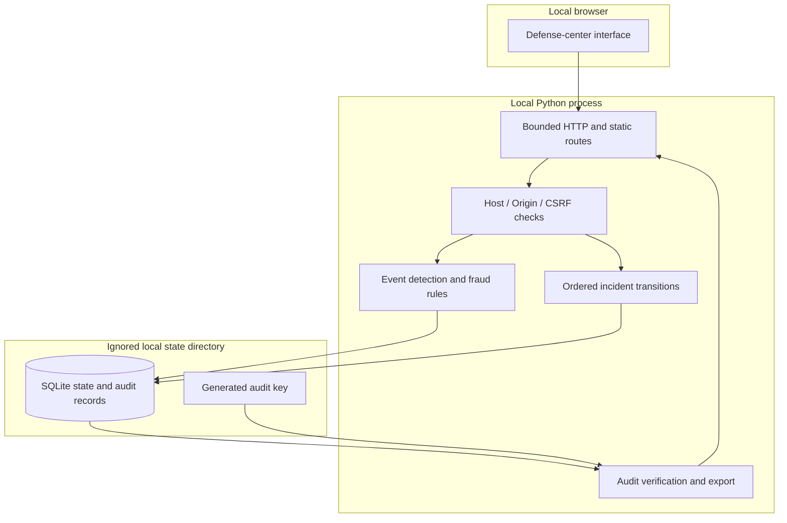

# Architecture and assurance boundaries

**Portbug Bank Cyber Defense Center · Made by Vaibhav Thakur.** Portbug Bank is a fictional Zurich institution. This document separates the running exercise from the production banking architecture it models.

## Running system

The application runs as one Python process serving local static assets and JSON APIs. It evaluates synthetic events, scores synthetic transactions, controls incident state transitions, and persists state together with a chained audit record. A browser is the only required client. There are no third-party runtime packages, remote fonts, external scripts, or required cloud services.

## Interfaces and data flows

| Interface | Purpose | Boundary and controls |
| --- | --- | --- |
| Static HTML/CSS/JS | Render the operator console | Fixed local assets, restrictive CSP, no external dependencies |
| `GET /api/health` | Local readiness response | Reports application availability; does not certify security |
| `GET /api/session` | Establish a browser write token | Same-origin local client; not a user identity or privileged login |
| `GET /api/state` | Read exercise state and audit summary | Synthetic records only, no secrets in the response |
| `POST /api/scenarios` | Generate and evaluate a bounded local fixture | Host/Origin checks, CSRF token, schema and scenario allowlist |
| `POST /api/respond` | Advance an exercise alert | Allowed action and ordered transition validation; attributable exercise audit |
| `GET /api/evidence` | Download a report for review | Excludes audit key; reports the chain check and local state |
| SQLite transaction | Persist a state change with audit evidence | Atomic updates; local filesystem permissions remain a host prerequisite |

The session token prevents cross-site writes; it is not authentication. Anyone who can access the trusted local application may operate the synthetic exercise. Do not expose this server as an organizational SOC or internet-facing bank application.

## Modeled bank zones

The console uses a bank-like topology to organize observations and responsibilities:

| Modeled zone | Representative assets | Intended production boundary |
| --- | --- | --- |
| Edge | Customer channel, reverse proxy/WAF | Authenticated ingress, TLS policy, bounded requests, restricted egress |
| Application | Banking API, payment orchestration, identity | Validated sessions/tokens, object authorization, service identity, separation of duties |
| Data | Synthetic ledger, audit storage, key services | Least-privileged access, encrypted storage, rotation and recovery |
| Management | Monitoring, response, administration, backup | Privileged identity separation, MFA, independent evidence, tested restoration |

These are **modeled assets**, not deployed containers or enforced network segments. An advanced production system would require tested network enforcement, real IAM, workload authentication, independent telemetry, off-host evidence, and separate recovery domains. The local application does not claim those controls.

## State and audit design

The data directory holds persistent exercise state, audit records, and a locally generated HMAC key. A mutation is accepted only when its state update and associated audit append can be committed consistently. Audit entries link to earlier evidence using HMAC-SHA256 and bind a digest of the saved state. A failed chain/state check prevents further mutations. The interface exposes verification results and abbreviated chain identifiers; exports must never include the key.

This detects unauthenticated modification when the verification key and expected history remain trustworthy. It does not prevent a host administrator with the key from rewriting the entire history, demonstrate non-repudiation, or replace immutable off-host logging. The database and key are in the same local trust domain. Deletion, rollback of both files, and unauthorized host access remain residual risks.

Initial findings and trend points are seeded fixtures. They are not measurements of a live bank, detection latency, prevented financial losses, or attack volume. Fraud scores come from deterministic explainable rules, not a trained ML model.

SQLite data is not encrypted by this application. File permissions and host disk encryption are the operator's responsibility. Backups need the corresponding audit key to remain verifiable and must not be copied into Git or untrusted storage. Recovery is described in [operations](operations.md).

## Application security decisions

- Bind to `127.0.0.1` by default. `0.0.0.0` exists for the container-internal listener; Docker must publish only on host loopback.
- Serve scripts and styles locally. Browser policy limits content to the application and prevents framing.
- Reject unexpected hosts/origins, unsupported actions, invalid JSON, excessive request bodies, and invalid state transitions. Request rate controls are defense in depth, not DDoS protection.
- Generate synthetic event records rather than sending traffic at targets. ATT&CK references describe the defensive observation, not an attack tool.
- Keep fraud scores explainable and advisory. No score can execute a real payment or bypass authorization.
- Keep demo response actions local. A contained exercise alert does not mean an account has been disabled in a real IAM system.

## Swiss residency and governance

The modeled bank is headquartered in Zurich and assumes Swiss-hosted business data, logs, backups, and administrative access. This repository does not locate the developer's machine, attest Swiss hosting, or prevent copying an export elsewhere. Synthetic data is mandatory everywhere.

Any future production design needs a primary-source applicability review for FINMA operational-risk/cyber guidance, Swiss data protection and banking secrecy, critical-infrastructure incident reporting, ISO/IEC 27001, NIST CSF, PCI DSS where card-data scope applies, SWIFT CSP where actual connectivity applies, and DORA where relevant. References are a review agenda; current editions, effective dates, triggers, and legal scope must be verified. See [operations](operations.md) for sources and [the threat model](threat-model.md) for remaining risks.
