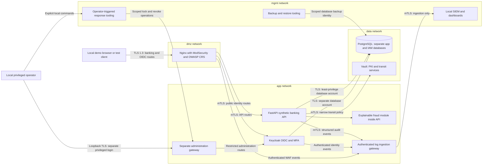

# Architecture

## Status and scope

This is the **proposed** architecture for `portburg-secure-bank`, a defensive
portfolio for the fictional Portburg Bank in Zurich. Phase 1 supplies the design
and documentation only. Containers, certificates, authentication flows, detections,
and encryption controls described here are not yet implemented or validated.
See the [project overview](../README.md) and [threat model](threat-model.md).

The demonstration will run on one developer-controlled machine using Docker
Compose. It will contain invented customers, non-routable account identifiers
such as `PB-DEMO-ACCOUNT-001`, fabricated balances, and synthetic events. It will
not connect to payment networks, SWIFT, actual banks, or customer services.

## Design assumptions

- The developer owns and administers the Docker host. Containers do not protect
  their contents from a host administrator or someone controlling the Docker
  daemon. This is one host, not an availability cluster.
- The modeled bank keeps its business data, logs, backups, and key services in
  Switzerland. Running this repository does not establish the location of the
  developer's machine, cloud workspace, container registry, or CI runner. Only
  synthetic data may be used in those environments. Swiss residency is a design
  assumption, not an attested property of this environment.
- Image and dependency downloads happen during preparation. Demo runtime has no
  required external API, external identity provider, cloud account, or telemetry.
- User-facing endpoints bind to loopback by default. Local TLS trust installation
  and certificate generation require explicit, documented setup in Phase 2.
- Compliance mappings are educational control mappings. They do not establish
  that a licensed bank could use this system or satisfy regulatory duties.

## Zones and components

Boxes show logical zones. A component connected to two zones is an explicit
bridge between them; its extra interfaces must not become a generic router.
Connections in the diagram are allowed application flows, not evidence that
network policy already enforces them. The fraud module is planned as an in-process
library initially, so it needs no additional exposed endpoint.

| Component | Proposed network membership | Purpose and exposure |
| --- | --- | --- |
| Nginx + ModSecurity/CRS | `dmz`, `app` | Only public demo entry point; loopback TLS listener. Deny management routes, enforce request limits, normalize forwarding headers, and emit WAF decisions. |
| FastAPI | `app`, `data` | Validate identity and ownership; expose only internal service listener; execute synthetic account and payment workflows. |
| Keycloak | `app`, `data` | OIDC, enrolled MFA, and separate customer/operator roles. Public identity routes are distinct from administration routes. |
| PostgreSQL | `data` | Separate databases and credentials for application and IAM; no published host port. |
| Vault | `data`, `mgmt` | Workload identity, short-lived PKI certificates, and narrowly authorized transit operations; no public listener. |
| Log ingestion gateway | `app`, `mgmt` | Accept bounded authenticated events and forward to SIEM; no arbitrary proxying or Docker socket. |
| Administration gateway | `app`, `mgmt` | Separate operator entry point bound to loopback; customer tokens cannot administer IAM. |
| SIEM and dashboards | `mgmt` | Local security monitoring; privileged loopback dashboard access only. Specific SIEM implementation is selected before Phase 4 installation. |
| Response and backup jobs | `mgmt`, with temporary scoped connectivity as required | Explicit operator invocation. Backup jobs need a documented, narrow path to the database; they do not justify exposing the database. |

The final Compose service list and tested network rules will be versioned in
Phase 2. Service-specific sidecars may terminate mTLS where a chosen component
cannot enforce client authentication directly. Such a sidecar must reject
untrusted certificates and prevent access to a plaintext backend from other
containers; enabling TLS alone is insufficient.

## Data flows and trust boundaries

| Flow | Boundary crossed | Required checks and retained evidence |
| --- | --- | --- |
| F1: browser to proxy | TB1: developer client to exposed service | Locally trusted TLS 1.3 certificate, restrictive headers, request size/rate limits, CRS decisions, no raw request-body logging. |
| F2: browser sign-in through proxy | TB2: public route to identity service | Authorization-code flow with PKCE for browser clients, exact redirect URI allowlist, MFA enrollment, no password grant, and rejection of administration routes. |
| F3: proxy to API | TB3: DMZ to application | mTLS peer identity plus independent JWT signature, issuer, audience, expiry, algorithm, and scope checks at API. Strip untrusted forwarding headers. |
| F4: API to account data | TB4: application to persistence | Per-customer object ownership, least-privilege database role, parameterized queries, TLS server verification, and transactions with idempotency controls for synthetic transfers. |
| F5: API to Vault | TB4: application to key service | Short-lived scoped workload authentication, transit key policy, audited key operations, and rejection of access to unrelated keys or PKI roles. |
| F6: services to collector/SIEM | TB5: business workload to security management | Authenticated ingest, schema validation, message size limits, synthetic identifiers, sensitive-field redaction, and correlation IDs. Logging cannot grant management access. |
| F7: operator to administration | TB6: customer context to privileged context | Dedicated privileged identity with MFA, role separation, short sessions, and explicit authorization of lock/revoke actions. |
| F8: backup and restore | TB7: active state to retained recovery state | Encrypted backup, access separation, retention limit, integrity check, restore into an isolated target, and comparison against known synthetic records. |

Banking requests cannot rely on the WAF or a valid token alone. The API must
check both permission and ownership for each operation. Role claims are inputs
to authorization; a customer role must never unlock operator functions.

Browser tokens must not be written to persistent browser storage. Phase 2 must
choose and document either a local test client with explicit short-lived tokens
or a server-side session/BFF before adding a browser UI. Cookie-backed sessions
will require `Secure`, `HttpOnly`, appropriate `SameSite`, CSRF protections,
server-side expiration, and session rotation after authentication.

## IAM and secret lifecycle

The initial role model separates `customer`, `fraud_analyst`,
`security_operator`, and narrowly scoped service identities. A customer accesses
only their synthetic accounts; an analyst reviews redacted fraud reasons; an
operator can run explicit incident actions. Realm administration belongs to a
separate privileged identity, never to an everyday customer or service account.

TOTP and WebAuthn are planned MFA options. Enrollment, recovery, revocation, and
the local secure-origin requirements of WebAuthn need functional tests before
claiming MFA works. Joiner/mover/leaver policy will cover role approval, access
review, removal of stale roles, and session revocation in Phase 6.

Vault will use persistent local storage with an operator-controlled initialization
and unseal workflow, rather than a development-mode server with a fixed root
token. Root access is for bootstrap only. Initialization output, unseal material,
workload credentials, and private keys must stay in local restricted files outside
the tracked checkout. `.env.example` will document variable names without values.
No private material is placed in image layers or Compose YAML.

Bootstrap necessarily precedes workload mTLS: an offline local trust root and
short-lived bootstrap identity establish Vault access, then scoped PKI roles
issue service certificates. Phase 2 must document initial trust distribution,
credential handoff, certificate renewal, restart behavior, and failure recovery.
Do not disable certificate verification to solve this dependency cycle.

Vault provides a software key-management demonstration. It is not an HSM and
does not establish tamper resistance, certified custody, or non-exportability
against the Docker host administrator. Transit encryption is planned for selected
synthetic fields; key-version rotation must preserve decryption of retained data.

## Network, DNS, and egress constraints

`app`, `data`, and `mgmt` are planned as internal Compose networks. Only the
public and privileged loopback gateways publish host ports. Databases, Vault,
API, and collector do not publish host ports. Avoid host networking, privileged
containers, Docker socket mounts, and runtime package installation.

Compose network membership is coarse connectivity control. Services sharing a
network can usually reach one another, and a multi-network container can bridge
zones. Compose alone is not a service firewall, an egress allowlist, or proof of
zero trust. Authentication and authorization are required on every permitted flow.
Phase 2 will test rejected cross-zone paths and document any host firewall or
explicit egress-gateway requirement for finer restrictions.

Runtime services should have no Internet dependency. The host controls image and
package downloads, with TLS and signature/checksum verification retained.
Containers resolve internal names through Docker DNS. That provides discovery,
not DNSSEC validation or protection from a compromised Docker host. An upstream
validating resolver or policy-enforcing DNS gateway is a later documented option;
external DNS is not needed for synthetic bank data flows.

## Cryptography and storage

The external gateway targets TLS 1.3. Internal protected flows target mTLS with
named peers, bounded certificate lifetimes, verified trust chains, and documented
rotation. PostgreSQL connections must verify server identity and use scoped
credentials; client-certificate authentication will be evaluated in Phase 2.
Never equate encryption in transit with authorization.

Docker named volumes are not encrypted at rest by default. Full-volume protection
depends on a verified encrypted host filesystem or an explicitly provisioned
encrypted storage layer. Application-level Vault transit protection covers only
the fields actually encrypted; database indexes, IAM state, logs, and backups need
their own assessment. Documentation and checks must identify the uncovered data.

Encrypted backups will use local recovery keys separated from backup storage,
with retention and rotation documented. Recovery of Vault state and key versions
must be tested alongside recovery of ciphertext. Replication, a successful backup
command, and a live container are not restore evidence.

## Runtime hardening and failure behavior

Phase 2 will target non-root processes, dropped Linux capabilities, read-only
root filesystems, limited writable volumes/tmpfs, resource limits, and health
checks appropriate to each image. Exceptions such as writable database storage
must be explicit. Images and Python dependencies will be pinned to reviewed
versions/digests; this design does not preselect untested tags.

Readiness checks must confirm dependencies and useful behavior. For example,
authenticated balance retrieval and a synthetic transfer with an ownership
rejection are stronger evidence than an open port. Database or Vault failures
must reject affected writes without partial updates. IAM failure must not bypass
authentication. Logging outages need bounded buffering and a visible degraded
state; the policy for high-risk writes without an audit trail must be tested.

The local demonstration will define and measure RTO/RPO targets in Phase 6. It
does not provide production high availability, DDoS absorption, immutable storage,
or regulated operational resilience on a single developer machine.

## Evidence required before calling the runtime ready

- `make up` performs a documented startup and verifies representative authenticated
  behavior from a clean local checkout.
- Negative tests cover invalid/missing tokens, wrong account ownership, privileged
  route isolation, rejected mTLS peers, blocked network paths, and rate limits.
- Certificate rotation, IAM enrollment/revocation, Vault restart/unseal, and
  dependency failures have reproducible local checks.
- Synthetic events reach the SIEM, and every detection rule has both matching
  and nonmatching fixtures plus an ATT&CK technique mapping.
- Backups restore known synthetic state into an isolated target, with measured
  recovery times and an explicit record of any unmet target.

These are acceptance criteria for later phases, not results of Phase 1 tests.
