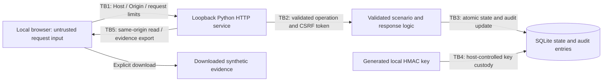
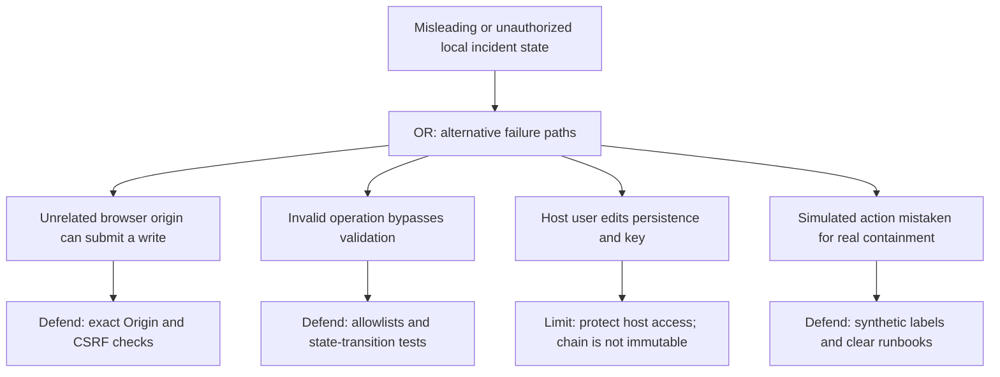

# Portbug Bank: threat model and assurance boundaries

**Made by Vaibhav Thakur.** Portbug Bank is a fictional private bank based in Zurich. This model describes a local defensive simulation, not the security assessment of a licensed financial institution.

## Scope and assets

The runnable system consists of a browser interface, a Python HTTP service, a deterministic synthetic detection/fraud engine, a local incident state machine, and SQLite persistence with a keyed audit chain. The browser presents invented security records; scenario buttons create local event fixtures. There are no real banking connections, customer records, identity-provider actions, or external security integrations.

| Asset | Security objective | Explicit limit |
| --- | --- | --- |
| A1: Synthetic event and incident state | Keep displayed decisions consistent, bounded, and attributable to a local operation | A simulated containment action does not lock an actual account or revoke a real token |
| A2: Detection and fraud logic | Explain each result and reject malformed or unsupported operations | Synthetic rules do not demonstrate real fraud/AML effectiveness or production detection coverage |
| A3: Audit chain and generated local key | Detect changes to retained entries when checked with the expected key and chain history | An administrator possessing the key can rewrite the chain; it is not immutable evidence or nonrepudiation |
| A4: Source and release contents | Reproduce reviewed behavior without runtime package downloads | Source review and tests do not replace production SCA, image signing, or independent assessment |
| A5: Local availability and saved demo state | Bound abusive input and restore an internally consistent local demonstration | One process and one host provide no production availability or fault-domain separation |

The host user, Python installation, browser, and operating system are trusted for ordinary operation. A malicious local administrator can inspect memory and files, replace code, or alter saved state. This is outside the protection provided by the demo. Swiss-only operation is a modeled bank requirement; this repository does not attest where a laptop, cloud workspace, CI runner, log, or backup is located.

## Trust boundaries

| Boundary | Required property | Why it matters |
| --- | --- | --- |
| TB1: Browser/network to HTTP handler | Loopback default, exact allowed Host, bounded requests, safe static routing | An unrelated website or unintended network client must not acquire a general-purpose local administration endpoint |
| TB2: HTTP handler to application operation | Same-origin checks and CSRF token on writes; allowlisted scenario/action fields; ordered response transitions | UI affordances are not authorization or validation; direct requests must follow the same operation rules |
| TB3: Application to persistence | Atomic state/audit persistence and bounded retained records | A failed operation must not leave a misleading partial incident update or unbounded event history |
| TB4: Audit verifier to local key/history | Verify the chain with the expected key; retain matching key and database | Detection of accidental or unkeyed modification depends on keeping the reference material trustworthy |
| TB5: State to browser/export | Serve JSON with safe content types; render strings as text; label exported data synthetic | Stored text and downloaded evidence must not become executable markup or be mistaken for actual bank telemetry |
| TB6: Repository to local execution | Reviewable source, automated tests on Windows/Linux, no runtime third-party package requirement | Reproducibility and regression checks reduce setup drift; they do not prove an artifact is vulnerability-free |

Host and Origin validation plus a CSRF token constrain browser-origin abuse. They do not provide user authentication or RBAC. Anyone with access to the permitted local service can operate this single-user demo. Do not expose it as a shared or Internet-facing service.

## STRIDE review by component

S = spoofing, T = tampering, R = repudiation, I = information disclosure, D = denial of service, E = elevation of privilege. These are potential failure classes to test and review, not claims of observed vulnerabilities.

| Component | S | T | R | I | D | E |
| --- | --- | --- | --- | --- | --- | --- |
| Browser interface | Misleading connection or environment labels | Untrusted strings inserted as active markup | Operator mistakes lack visible operation results | Export or UI reveals local state | Oversized rendering work freezes the tab | UI offers invalid response transitions |
| HTTP service | Forged Host or unrelated website reaches local API | Malformed body or unexpected route changes state | Write lacks an associated audit action | Unsafe path resolution or error text exposes local files | Large body, burst requests, or slow clients consume service resources | Browser-origin controls are mistaken for authentication |
| Scenario/detection engine | Fabricated source identity mistaken for real telemetry | Rule logic or fixture changes alter matches | Decision lacks a source scenario and explanation | Overly detailed invented records normalize unsafe logging | Unbounded fixture growth exhausts memory/storage | Detection score is used as permission to act on real systems |
| Fraud scoring | Wrong synthetic account attributed to a signal | Changed inputs or thresholds alter the result | Score lacks contributing reasons | Unnecessary account details appear in export | Oversized input or unsupported values break evaluation | Advisory review score becomes an authorization bypass |
| Incident response state machine | Action appears to originate from an actual SOC identity | Skipped states or invalid action mutates an incident | Status changes lack audit records | Incident details disclose local operational state | Repeated actions create unlimited records | Simulated containment is misrepresented as real IAM enforcement |
| SQLite and audit key | Wrong key/history presented as authentic | Entries, state, or key are edited on disk | Local administrator rewrites chain and history | Plain SQLite file or key copied by another host user | Disk full, corruption, or missing key prevents normal operation | Host file access is treated as hardware-backed key custody |
| Source and delivery | A modified repository resembles the reviewed release | Workflow or logic changed without meaningful tests | Release evidence does not identify tested revision | Generated keys/databases accidentally committed | Platform drift breaks startup | CI permissions or container exposure exceed the demo scope |

## Controls and acceptance evidence

The [risk and control register](control-register.csv) assigns each risk a likelihood, impact, owner, treatment, control status, evidence requirement, and document reference. Scores are illustrative prioritization values from 1–5 multiplied together. They are not measured bank risk estimates.

| Control | Implemented demo behavior or explicit requirement | Acceptance evidence |
| --- | --- | --- |
| C-01: Local exposure boundary | Loopback by default; exact Host validation; optional container entry published only to loopback | Startup configuration plus accepted/rejected Host and local HTTP checks |
| C-02: Write-request protection | Exact Origin and CSRF checks on mutation routes; allowlisted JSON fields | Allowed write succeeds; missing/incorrect token and unrelated Origin are rejected |
| C-03: Bounded input and operation rules | Request limits, allowlisted scenarios/actions, ordered response transitions | Oversized/invalid input fails without changing state; triage, contain, resolve succeed only in order |
| C-04: Browser isolation | Restrictive CSP/security headers, local static assets, text-safe rendering | HTTP header checks, JavaScript syntax checks, and functional UI review |
| C-05: Atomic local evidence | SQLite state and audit updates; HMAC-SHA256 chained entries with generated local key | Persistence/restart checks; valid chain passes; changed entry or wrong key fails verification |
| C-06: Explainable synthetic analysis | Actual rule evaluation and reason-bearing fraud results | Positive and negative event fixtures, boundary values, and expected reason-code/score tests |
| C-07: Delivery hygiene | Source checks, no committed runtime key/database, Windows/Linux CI configuration | `python3 tools/check.py`, `python3 -m unittest discover -s tests -v`, and reviewed CI run results |
| C-08: Production identity and cryptography | **Planned requirement:** authenticated multi-user access, real MFA/RBAC, TLS/mTLS, protected key custody, encrypted storage | Not implemented or attested by this demonstration; requires a separately scoped production design and verification |
| C-09: Operational resilience | **Planned requirement:** independently protected backups, recovery targets, monitored capacity and failover | The local demo has no HA or guaranteed RTO/RPO; follow the [operations guide](operations.md) for limited local recovery |
| C-10: Honest presentation and residency | Synthetic labels and documented limits; no regulatory certification or hosting-location claim | Review README, UI, exports, and this model; verify real deployment provenance before any residency claim |

Run the checks against the exact revision being reviewed. A listed acceptance check is a requirement, not proof it passed in an unspecified environment. CI configuration also needs a completed remote run before CI success can be claimed.

## Conceptual attack tree

This is a defensive review tree, not an exploitation procedure.

## Residual risks and release limits

- **No multi-user identity boundary:** this is a trusted-user loopback application, not an authenticated bank operator portal. A CSRF token is not a login credential or a substitute for authorization.
- **No production encryption claim:** local HTTP is not TLS; SQLite is not encrypted; a software HMAC key is not an HSM. Protect the host and use synthetic data only.
- **No immutable audit claim:** a database and key controlled by the same administrator cannot establish independent nonrepudiation. A valid retained chain does not independently prove there was never a truncated or replaced history.
- **No automated real-world containment:** response buttons update synthetic state. They do not lock real accounts, revoke identity-provider tokens, block network traffic, or prevent actual fraud.
- **No comprehensive detection claim:** deterministic fixtures demonstrate rule behavior under selected cases. Unknown techniques, adaptive attackers, production baselines, clock skew, and broad false-positive rates are outside that evidence.
- **No regulated-bank readiness claim:** external IAM, WAF/SIEM integrations, verified encryption, independent recovery, signed releases, current legal applicability review, and Swiss residency remain separate requirements.

Revisit this threat model before adding any external connection, public listener, multi-user capability, real data, banking integration, or production assurance claim. See [architecture](architecture.md), [operations](operations.md), and [incident playbooks](incident-playbooks.md).
