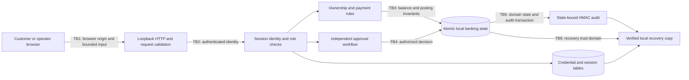

# Threat model: secure banking workflows

**Portbug Bank · Zurich · Made by Vaibhav Thakur.** This model covers a local banking application with synthetic CHF balances, payments, approval cases, and security operations. Portbug Bank is fictional; no payment leaves the application or reaches a banking network.

## Security objectives

The useful security question is whether a control governs a real application operation. A payment form, a risk score, and an approval button must therefore be checked against the server-side ledger and identity boundary, not treated as evidence by themselves.

| Asset | Required property |
| --- | --- |
| Account ownership and private statements | Each user sees authorized account data and can debit only their own active accounts, including when the caller is an administrator |
| Synthetic funds and ledger receipts | Integer-cent arithmetic, no overspending, atomic postings, conserved funds, and an unambiguous history of held and completed payments |
| Payment decisions | A high-risk payment requires an authorized operator other than its creator; a repeated decision cannot pay or refund twice |
| User credentials and sessions | Operator-chosen passwords, salted scrypt hashes, bounded login attempts, expiring server-side sessions, and optional confirmed TOTP enrollment |
| Rule configuration and security records | Only authorized roles change policy or inspect security evidence; rule explanations and backtest results remain reviewable |
| Audit and recovery material | Domain-state changes bind to a keyed audit chain; a verified backup preserves the database and corresponding key together |

## Actors, scope, and trust

- A **customer** operates their own synthetic accounts and reads their own banking history.
- An **operator** reviews held payments and security evidence. That role does not authorize debiting another customer's account.
- An **administrator** provisions local users and changes risk thresholds. Administrative access does not override payment ownership or the prohibition on self-approval.
- An **untrusted browser origin** may attempt to reach the local service. Host, Origin, CSRF, cookie, and request-validation controls constrain that boundary.
- The **host owner** controls the code, database, runtime, and local keys. A hostile host owner is outside the assurance provided by this application.

The first-run administrator chooses their own credentials. There are no shipped login credentials. Start setup on a trusted machine with the loopback listener; whoever legitimately claims the first local workspace obtains its administration role. The app is not intended as an unattended public onboarding endpoint.

Local HTTP, the Python runtime, the browser, and the host filesystem form the operating environment. SQLite and TOTP enrollment material are not encrypted by the application. Swiss residency is a modeled requirement of the fictional bank, not an attestation of a laptop, cloud workspace, CI runner, export, or backup location.

## Trust boundaries

The server must enforce these properties for direct API calls as well as UI interactions. Hiding a navigation item is not a role check. A client-supplied account ID, payment status, amount, risk score, or username is not trusted authority.

## STRIDE review

S = spoofing; T = tampering; R = repudiation; I = information disclosure; D = denial of service; E = elevation of privilege. The rows describe failures to prevent and test, not observed vulnerabilities or completed test results.

| Component | S | T | R | I | D | E |
| --- | --- | --- | --- | --- | --- | --- |
| Setup, login, and MFA | Wrong principal accepted or initial setup claimed unexpectedly | Enrollment or session state changed outside its owner | Sign-in and enrollment decisions lack safe security records | Password, TOTP secret, or token leaks through a response or log | Repeated expensive password checks exhaust the local process | A customer becomes an operator or administrator |
| Browser and HTTP adapter | Forged Host or unrelated Origin reaches a trusted endpoint | Cross-site mutation or malformed JSON bypasses validation | A displayed action disagrees with the accepted operation | Unsafe rendering, path handling, or errors expose data | Oversized bodies, bursts, or slow requests exhaust resources | UI-only restrictions replace server-side checks |
| Account projection and banking reads | Caller chooses another owner's identity | Client parameters alter account ownership or balances | Statement lacks stable payment references | Another customer's balances or raw security events are returned | Unbounded history rendering or queries consume resources | Administrator privileges bypass debit ownership |
| Payment creation and ledger | Caller spends as another account owner | Decimal errors, replayed requests, or concurrent writes create inconsistent funds | Payment intent cannot be tied to its receipt and creator | References or recipient data leak beyond authorized views | Excess requests fill retained financial records | Client declares a risky payment settled or skips a hold |
| Risk policy and backtesting | Untrusted caller impersonates policy administrator | Threshold changes silently weaken review or reported results | Changed policy lacks an audit record | Security fixture details appear in customer views | Unbounded evaluation input consumes resources | Customer/operator obtains policy-write authority |
| Held-payment review | Creator acts as an independent reviewer | Repeated or conflicting decisions credit or refund twice | Decision has no reviewer, note, or timeline | Review records escape security roles | Repeated actions obstruct legitimate review | Customer approves a hold or creator approves their own payment |
| Persistence, audit, and backup | Wrong key or history presented as expected evidence | State, authentication tables, audit entries, or backup are edited | Host administrator rewrites evidence | Plain database, key, and backups are copied | Corruption, disk exhaustion, or key loss prevents startup/recovery | Filesystem access is mistaken for protected key custody |

## Payment invariants and adversarial checks

The ledger and state machine are the highest-priority correctness boundary:

1. Parse CHF input into integer cents. Reject negative, zero, excessive, non-finite, or unsupported-precision amounts rather than rounding an ambiguous payment.
2. Validate ownership, account state, beneficiary, reference bounds, and available funds before accepting an intent. Customer-facing banking operations use the authenticated identity, not an owner supplied by the browser.
3. Accept a payment and its ledger/audit effects atomically. Competing requests must not both spend funds that only one request can cover.
4. Reserve the sender's amount immediately for a held payment. Approval credits the recipient once; rejection refunds the sender once. The sum of account balances plus pending held amounts remains constant for transfers.
5. Bind an idempotency key to its authenticated creator and payment intent. An identical retry returns the original receipt; reusing the key with a different intent is rejected.
6. Require a supported pending state, an authorized distinct reviewer, and a decision note. Reject self-approval, repeated decisions, and attempts to edit a completed receipt.

An independent reviewer means a different authenticated local user. It does not prove real-world organizational independence: a trusted administrator can provision users, and the host owner controls the entire local environment.

## Control and evidence matrix

| Control boundary | Expected behavior | Acceptance evidence |
| --- | --- | --- |
| Identity | Password verification uses salted scrypt; sessions expire and logout invalidates them; TOTP is enforced after confirmed enrollment | Correct/incorrect password, token expiry/logout, enrollment, invalid OTP, and published TOTP-vector checks |
| Browser request integrity | Exact Host/Origin checks and a session-bound CSRF token protect writes; private assets are served through explicit routes | Valid operation succeeds; foreign/missing origin, missing/wrong token, unexpected fields, oversized body, and path traversal fail |
| Role and ownership separation | Customer views are filtered; operations require the appropriate role and resource ownership | Cross-customer reads/debits and customer access to users, policy writes, review decisions, and evidence export are rejected |
| Financial consistency | Amounts, holds, postings, and receipts obey the payment invariants | Settlement, rejection/refund, insufficient funds, concurrent requests, duplicate submission, and conservation checks |
| Decision integrity | Only a distinct authorized reviewer can conclude a pending payment | Own-approval, unauthorized review, repeated/conflicting decision, and missing-note checks; accepted decision records its actor |
| Explainable risk | Held payments expose reasons; policy evaluation produces deterministic labeled-case results | Threshold and velocity boundaries, benign/risky fixtures, expected confusion matrix, and non-mutating backtest checks |
| Audit and persistence | Domain-state mutation and keyed audit append commit together; invalid retained state blocks normal mutation | Restart persistence, changed state/entry, wrong key, malformed state, missing-state, and failed-operation rollback checks |
| Recovery | A verified isolated copy retains banking state, authentication data, and the matching audit key | Restore comparison and successful post-restore operation; protect the backup as sensitive local material |

These are review and test requirements. Consult the actual test output and the exact revision under review before saying a requirement passed. A CI file is not a completed CI run, and a matching synthetic fixture is not proof of production fraud effectiveness.

## Audit assurance and residual risk

The HMAC-SHA256 chain binds saved **banking domain state** to retained audit entries. Authentication users, password hashes, TOTP enrollment, and session tables are separate local records; they are not covered by that domain-state digest. Backups include those tables so the restored application retains its users, but that does not add independent integrity protection to them.

The verification key and database share a host trust domain. An administrator with the key can construct another valid history, and restoration of an older matching database/key snapshot cannot be distinguished from an intended rollback without an independent checkpoint. The chain is not immutable storage, nonrepudiation, or hardware-backed key custody.

Optional TOTP protects an enrolled login against password-only access; it does not make an HTTP connection encrypted, protect a compromised host, or establish step-up authorization for every payment. This local app provides no production identity provider, device binding, HSM, external monitoring, or real payment connectivity.

Revisit the model before adding public exposure, real customer data, an external payment rail, multi-host services, or a regulated deployment claim. See [architecture](architecture.md), [operations and recovery](operations.md), and the [project overview](../README.md).
