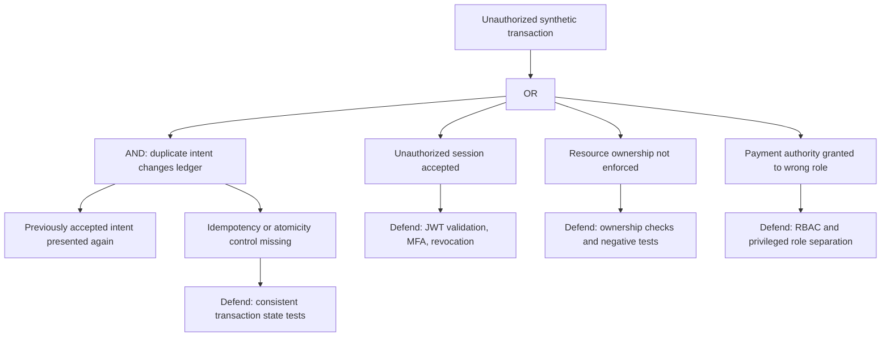
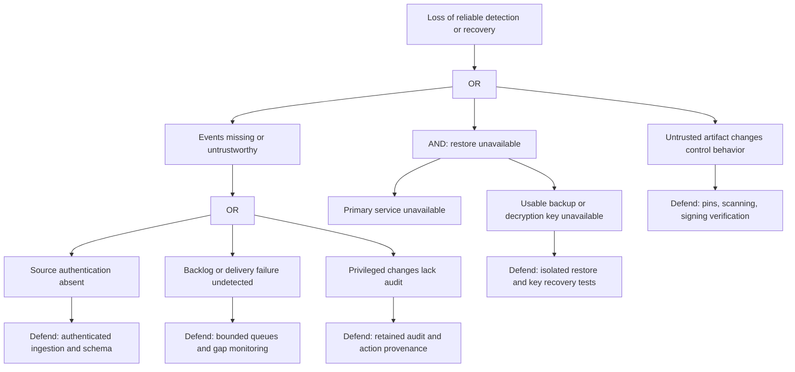

# Portburg Bank threat model

## Status and scope

This is the Phase 1 design for a **fictional** Zurich bank and a local defensive learning environment. Every runtime mitigation and validation scenario below is **planned, not implemented or tested**. A diagram or control description is not evidence of security. Review this model after each implementation phase and whenever a trust boundary changes.

The scope is the demo API, reverse proxy/WAF, IAM, secrets service, synthetic persistence, fraud analytics, detection pipeline, local host, and software delivery. There are no connections to payment networks, SWIFT, real banking systems, customer accounts, production identities, or third-party intelligence services. Payment-change and SWIFT-pattern events are synthetic labels only. Security tests must stay within the local demo and use controlled fixtures; this document supplies no exploitation procedures.

See [architecture](architecture.md) for the proposed zones and flows. Framework editions, legal applicability, and reporting obligations must be verified against authoritative sources in Phase 6; this model does not assert compliance or certification.

## Assets and security objectives

| Asset | Objective | Loss to demonstrate with synthetic data |
| --- | --- | --- |
| A1: Demo identities, sessions, roles | Authenticate the intended synthetic principal; enforce least privilege | Unauthorized access to another demo user's resources |
| A2: Synthetic account balances and transaction intents | Preserve ownership, integrity, and consistent state | An unauthorized or duplicated demo transfer |
| A3: Local secrets, service identities, signing and encryption keys | Restrict use, rotation, and recovery to authorized services/operators | Unauthorized decryption or forged service identity |
| A4: Audit events, alerts, fraud explanations | Preserve provenance, redact sensitive fields, support investigation | Missing evidence or an unexplained risk decision |
| A5: Source, dependencies, images, configuration | Reproduce reviewed builds and reject untrusted artifacts | A modified dependency/configuration reaches the stack |
| A6: Service availability, backups, recovery instructions | Restore measured service within documented targets | A local outage or an unrecoverable synthetic dataset |

All examples must use conspicuous, non-routable identifiers such as `PB-DEMO-ACCOUNT-001`, not valid banking identifiers. Synthetic identities do not remove the need to protect locally generated secrets. Application logs must exclude passwords, tokens, cookies, private keys, and complete account payloads.

## Actors and assumptions

- **Demo customer:** can authenticate and submit ordinary requests for their own synthetic accounts; must not read or change another customer's records.
- **Untrusted client:** can reach only the published demo entry point and submit bounded, local test requests. It has no trusted role or direct data-network access.
- **Compromised service:** is modeled as able to act with that service's identity. Per-service authorization and constrained reachability must limit the consequence.
- **Operations analyst:** may inspect redacted alerts and investigation records; this must not imply payment authority, IAM administration, or Vault administration.
- **Privileged operator:** controls local Docker and can ultimately inspect containers/volumes. The stack cannot defend its secrets against a hostile Docker host administrator.
- **Dependency or configuration supplier:** may introduce a vulnerable or altered artifact. Integrity, provenance, scanning, and review are separate checks.
- **Accidental operator error:** includes unsafe port publication, log oversharing, lost encryption keys, or an untested restore.

The local host is trusted for normal operation. A managed cloud workspace is not presumed to be in Switzerland. Swiss-only residency is a target operating assumption requiring a verified Swiss host and backup location; it is not established by this repository. Docker network isolation does not provide a complete zero-trust or egress control system.

## Trust boundaries and data flows

| Boundary | Flow | Required checks in later phases |
| --- | --- | --- |
| TB1: Developer client to exposed service | Demo client to TLS reverse proxy/WAF | TLS policy, bounded requests, safe error handling, entry-point rate limits |
| TB2: Public route to identity service | Browser sign-in through proxy to Keycloak public routes | Authorization-code flow with PKCE, exact redirect URI allowlist, MFA enrollment, no password grant or administrative routes |
| TB3: DMZ to application | Proxy to FastAPI | mTLS peer identity, explicit routing, no bypass port; independent JWT issuer, audience, signature, algorithm, expiry, role, and scope checks using trusted IAM metadata |
| TB4: Application to persistence and key service | API/IAM to separate PostgreSQL databases; API to Vault | Verified encrypted channels; separate least-privileged database identities; per-resource ownership and atomic writes; scoped Vault policies, short lifetimes, audited key use and rotation |
| TB5: Business workload to security management | Redacted events through authenticated ingestion gateway to SIEM | Schema validation, bounded queues, provenance, access restrictions, no general management proxying |
| TB6: Customer context to privileged context | Operator through separate administration gateway; explicit response operations | Dedicated privileged identity with MFA, role separation, authorized and attributable lock/revoke actions; scoped local Vault/SIEM administration |
| TB7: Active state to retained recovery state | Database/Vault state to encrypted backup and isolated restore target | Separate recovery access and keys, retention, integrity/consistency checks, measured restore and key recovery |
| TB8: Source to running artifact | Repository, package/image registries, CI, Compose | Lockfiles, verified artifacts, scans, policy checks, SBOM and signing/provenance verification |

TB1–TB7 match the boundary IDs in [architecture](architecture.md); TB8 extends that runtime view to software delivery. The fraud module initially runs inside the API without a separate listener. PostgreSQL uses separate application and IAM databases/credentials; the administration and ingestion gateways are explicit, restricted bridges between application and management zones.

The eventual management interface must be restricted to local administrative access rather than an unrestricted published port. The data and management zones must not become a transit path from the DMZ. Dependency downloads are a build-time requirement, not permission for unrestricted runtime egress.

## STRIDE coverage per component

S = spoofing, T = tampering, R = repudiation, I = information disclosure, D = denial of service, E = elevation of privilege. The following IDs group threats by component for control and validation tracking; each row considers all six categories. Threats describe potential failures, not observed vulnerabilities.

| ID / component | S | T | R | I | D | E |
| --- | --- | --- | --- | --- | --- | --- |
| TM-01: Reverse proxy / WAF | Forged forwarded client identity | Altered routing, headers, or WAF policy | Requests lack correlation evidence | Verbose errors disclose internals | Excessive requests or oversized bodies | Exposed management route or bypass to API |
| TM-02: FastAPI / account API | Wrong issuer/audience accepted as a user | Invalid or repeated transaction intent changes state | Actor/action/resource absent from audit | Cross-account reads or sensitive response/log fields | Unbounded queries, queues, or requests exhaust resources | Object ownership or role checks omitted |
| TM-03: Keycloak / IAM / administration gateway | Stolen or incorrectly validated session accepted | Role, MFA, or federation settings changed | Administrative changes not attributable | Tokens, sessions, or identity attributes exposed | Login/session dependency unavailable | Customer or analyst obtains operator role |
| TM-04: Vault / service identity | Workload impersonation or shared bootstrap identity | Secret/key policy or version changed | Key/secret access not audited | Unsealed material, tokens, or backups disclosed | Seal, lease, or key dependency blocks service | Broad policy grants cross-service secret access |
| TM-05: PostgreSQL / backups | Untrusted workload accepted as data client | Balance, ledger, or backup modified | Change provenance or restore evidence missing | Data/backup readable outside authorized role | Full volume, lost backup, or failed restore | Data client gains administration privileges |
| TM-06: Ingestion gateway / SIEM / response | Forged source event or operator identity | Event content, detection rule, or response request altered | Alert/response actions not attributable | Logs expose secrets or excess identity attributes | Event flood, backlog, or collector outage hides activity | Analyst or automation gains unconstrained account control |
| TM-07: Fraud module / features | Event attributed to the wrong account | Features, thresholds, training fixture, or explanation changed | No rule/model version for a decision | Excessive features reveal synthetic identity history | Large batches or unavailable scorer block processing | Risk score used to bypass authorization or execute payments |
| TM-08: CI / dependencies / images | Untrusted artifact presented as reviewed build | Dependency, workflow, image, or policy changed | Build inputs and review history not retained | Secrets leak through CI artifacts or logs | Dependency outage or resource-heavy job blocks delivery | Workflow or build receives excessive host/repository privileges |
| TM-09: Docker host / networks | Unauthenticated operator or service access | Compose, DNS, mounts, or runtime policy changed | Host actions lack an attributable trail | Docker socket, host mounts, or published ports expose data | Resource exhaustion or host failure stops stack | Privileged container or socket access reaches host authority |

## Planned controls and evidence

These evidence requirements are acceptance gates for later work. They are not checks that passed in Phase 1. Every negative application check must also include an allowed-path check, so a service that rejects everything cannot pass as secure.

| Threats | Planned control and response | Required evidence / owner |
| --- | --- | --- |
| TM-01 | TLS 1.3 at entry; OWASP CRS policy with documented exclusions; request/body limits; trusted proxy header handling; no direct API publication | Phase 2: allowed request succeeds; bounded synthetic invalid request rejected; bypass and TLS checks. App/platform owner |
| TM-02 | Schema validation; resource ownership and explicit RBAC; verified JWT claims; atomic/idempotent transaction handling; redacted, structured audit | Phase 2: cross-user access and unauthorized role denied; malformed/expired/wrong-audience token rejected; repeat intent does not duplicate a write; logs contain expected fields without secrets. App owner |
| TM-03 | Separate customer/analyst/operator roles; mandatory MFA for privileged access; session lifetime and revocation policy; joiner/mover/leaver procedure | Phase 2: privileged flow cannot finish without MFA; role separation verified; disabled user/revoked session behavior measured and documented. IAM owner |
| TM-04 | Locally generated secret material; separate scoped service policies; authenticated encrypted channels; rotation and audited access; operator bootstrap isolated from application | Phase 2: cross-policy access denied, expected lease renewal/expiry tested, retired credentials rejected after rotation while retained transit key versions still decrypt authorized data. Platform owner |
| TM-05 | Least-privileged persistence identity; encryption/backup key custody; integrity and consistency checks; tested recovery | Phase 6: restore into a clean isolated target, verify synthetic record counts/invariants and key availability, measure actual RTO/RPO. Data/recovery owner |
| TM-06 | Validated redacted event schema; authenticated collector; retention/access policy; monitor delivery gaps; response scripts scoped to synthetic accounts with audit and dry-run default | Phase 4: every Sigma rule has a positive/negative fixture and ATT&CK ID; queue/collector failure is visible; account-lock/token-revoke action rejects unauthorized scope. Detection owner |
| TM-07 | Local deterministic rules and a simple explainable model; versioned feature contracts; bounded inputs; score is advisory, never authorization | Phase 5: synthetic normal/velocity/geo/mule cases produce expected reasons; malformed and oversized inputs bounded; model cannot submit a transaction. Fraud owner |
| TM-08 | Dependency pins and integrity checks; SAST/SCA/secrets/IaC/container scans; minimal CI permissions; CycloneDX SBOM; signed image and verification policy | Phase 3: scanner jobs actually run and fail on controlled local test findings; signing verification rejects untrusted artifact. CI green only after a verified run. DevSecOps owner |
| TM-09 | No privileged mode or Docker socket mount; non-root/read-only workload defaults where supported; segmented networks; local-only admin access; explicit egress/DNS design; resource bounds | Phase 2: effective Compose configuration and reachability matrix verified. Phase 6: controlled dependency loss and recovery checks without host disruption. Platform owner |

Vault is not itself an HSM; software key custody and a future HSM integration option must be distinguished. Volume encryption is a host/storage prerequisite unless a component explicitly implements encryption. mTLS authenticates a workload; it does not grant object-level access. A WAF supplements application validation and authorization.

## Conceptual attack trees

The following are review trees for defensive control selection. They contain no operational attack steps. OR nodes represent alternative paths; AND nodes require all listed conditions.

## Residual risks and review gates

| Residual risk | Limitation / planned disposition |
| --- | --- |
| A single Docker host is a shared failure and administration domain | Segmentation cannot establish production bank isolation or high availability. Document and test local failure recovery in Phase 6. |
| MFA and revocation do not eliminate session theft | Minimize token scope/lifetime; document access-token revocation latency and test it in Phase 2. |
| An encrypted backup can still be unusable | Treat key recovery, restore consistency, and retention as one testable workflow in Phase 6. |
| Synthetic fraud and detection fixtures are narrow | Test negative cases, document false positives and limited coverage in Phases 4–5; do not claim real fraud or AML effectiveness. |
| WAF and scanners miss defects | Keep authorization, dependency review, configuration review, and meaningful runtime tests as separate controls. |
| Local software secrets management is not hardware assurance | Do not claim HSM protection; document administrative access and unseal/key recovery limitations. |
| Local residency and compliance are unverified | Verify hosting/backups and current authoritative legal/framework references in Phase 6. No production or legal assurance is implied. |

Phase 1 is complete only when the design and scaffold checks pass. Phase 2 must prove the local startup, identity, service channels, authorization, segmentation, and secret-handling workflow. Phase 3 must provide actual scanner outcomes. Phases 4–5 must prove detection and fraud behavior with synthetic positive/negative cases. Phase 6 must connect these threat IDs to owned risks, control evidence, playbooks, and measured recovery. Phase 7 must publish only badges and claims backed by completed evidence.
